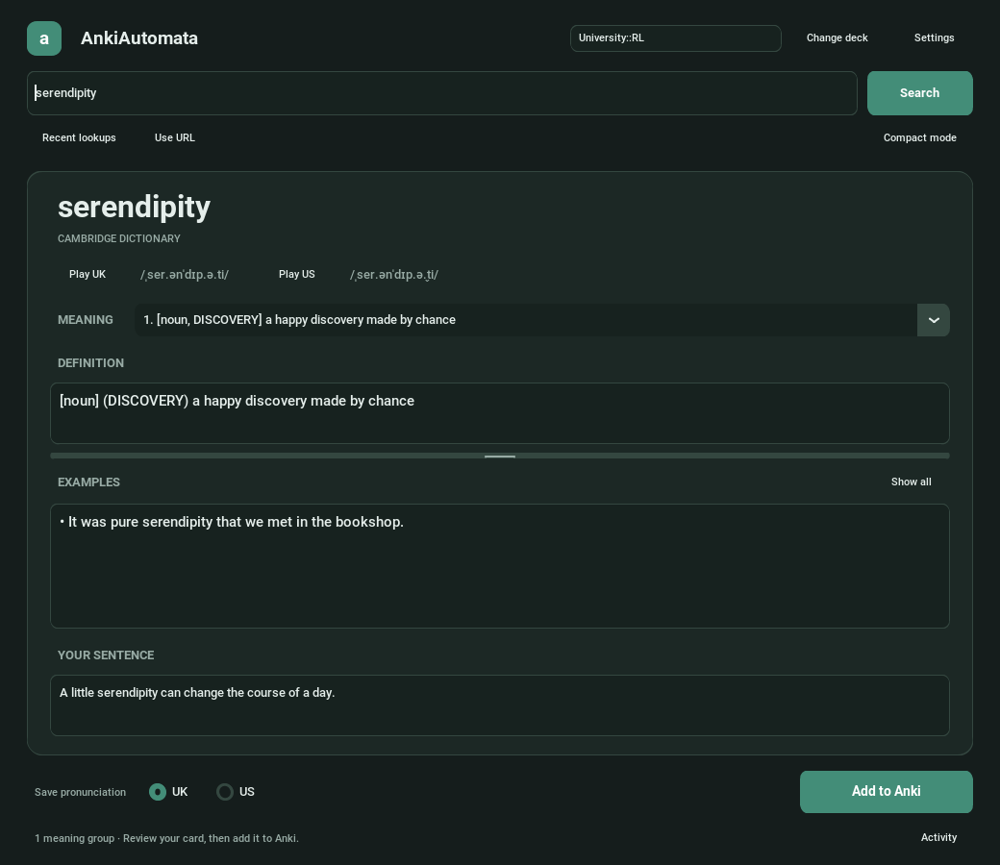
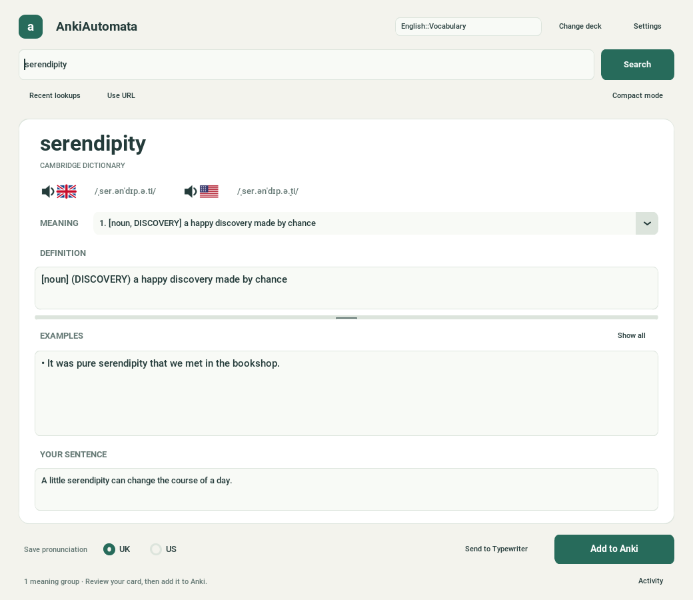
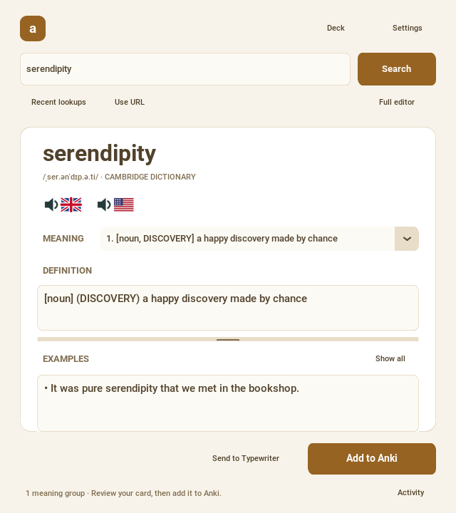

# AnkiAutomata

A focused desktop workspace for turning words from your reading into Anki cards. Select a word in your PDF, press **Ctrl+Alt+W**, choose its meaning, and add the card with Cambridge definitions, examples, IPA, and UK or US audio.



<details>
<summary>Light theme and compact mode</summary>





</details>

## Features

- **Selected-text shortcut:** searches highlighted words or phrases without changing your clipboard; opens the app if it is closed.
- **Focused editor:** warm light and charcoal dark themes, a teal accent, adjustable text sizes, and a collapsible activity log. Settings offers Sage, Ocean, Plum, and Amber color schemes, each with light and dark appearances.
- **Responsive lookups:** dictionary requests, duplicate checks, audio downloads, deck loading, and exports run in the background. Results from older searches cannot overwrite your latest lookup.
- **Internet proxy:** Settings → Network supports HTTP and SOCKS5 proxies, optional authentication, and a background connection test. Dictionary lookups and all pronunciation sources share the selected route; local Anki and Typewriter connections stay direct.
- **Compact mode:** a smaller window for reading beside a PDF. Switch back to the full editor to work with sentence context and additional controls; your edits stay intact.
- **Useful duplicate handling:** compares the exact rendered Front field for the configured note type in the selected deck and its subdecks. Existing cards get a preview and an **Open in Anki** action. Matches inside examples or longer words do not block a lookup, and duplicates are checked again before exporting.
- **Typewriter integration:** send the reviewed word, definition, and sentence to the running Typewriter app without clearing your Anki draft or overwriting an existing Typewriter word.
- **Recent lookups and recovery:** the twenty most recent words retain their edited definitions, examples, sentence, meaning selection, deck, and audio choice. Drafts autosave after a short typing pause and recover when you reopen the app.
- **Cambridge meanings:** extracts definitions and examples, groups related senses by part of speech and guideword, and lets you select one group or combine them all.
- **Pronunciation:** speaker/flag buttons play UK and US audio. Recordings and IPA must come from an entry matching the exact headword; choosing a meaning also selects its entry’s pronunciation. Redirected base words and unrelated entries cannot supply audio. A missing regional recording falls back to an available one. Re-search older drafts to refresh pronunciation links.
- **Alternative voices:** when Cambridge has no recording or a recording fails to download, the voice chooser searches Oxford, Wiktionary, and the Free Dictionary API. Open **Other voices…** at any time, use **Current voice is wrong** to reject a recording, preview the alternatives, then choose **Use this voice**. Choices and rejections survive restarts and new searches for the same word. Selected audio exports in its original MP3, Ogg, or WAV format with source and license credits; Cambridge IPA is not attached to a different source’s recording. Unavailable sources do not block results from the others.
- **Editable card content:** preserves line breaks, indentation, and highlighted target words while escaping plain text correctly for Anki HTML.

## Installation

You need Python 3.10+, Tkinter, and Anki Desktop with the [AnkiConnect add-on](https://ankiweb.net/shared/info/2055492159). In Anki, use **Tools → Add-ons → Get Add-ons**, enter `2055492159`, and restart Anki.

```bash
git clone https://github.com/SMani24/AnkiAutomata.git
cd AnkiAutomata
python3 -m venv envAnkiAutomata
source envAnkiAutomata/bin/activate
pip install -r requirements.txt
```

On Windows, activate the environment with `envAnkiAutomata\Scripts\activate`. Linux distributions may package Tkinter separately, for example `sudo apt install python3-tk`.

Keep Anki Desktop running, configure the note type below, and launch:

```bash
python main.py
```

For a Linux application-menu entry, application icon, and desktop shortcut, run:

```bash
python desktop.py --desktop
```

The installer replaces this project's older generic launcher and keeps the virtual-environment interpreter. Clicking the launcher focuses an existing window instead of opening another copy. Omit `--desktop` if you only want the menu entry. Run the installer again after moving the repository.

To use **Send to Typewriter**, start Typewriter at `http://127.0.0.1:8080` and review a word in AnkiAutomata. Sending keeps your Anki draft and preserves any existing Typewriter word and its progress. For a different local port, set `preferences.typewriter_url` in `config.json`. Audio checking and spelling-tip preparation remain in Typewriter.

Audio playback initializes the audio device only when requested. You can browse and edit dictionary results while Anki is offline; Anki must be available when adding cards.

Alternative recordings require an exact matching headword and a successful preview before selection. Wikimedia recordings also require author and license information. Rejecting the current recording keeps your definitions and edits, and saves cards without audio until you choose another voice. **Reconsider rejected** makes rejected options available for review again. Source availability varies by word and network access.

To use a proxy, open **Settings → Network**, enable **Route internet requests through a proxy**, and enter its protocol, host, and port. Enter the hostname or IP address without a URL prefix; username and password are optional. **SOCKS5 (proxy DNS)** also routes hostname resolution through the proxy. **Test connection** checks the values currently shown without saving them. Choose **Save network settings** to apply them to new requests immediately; requests already running keep their previous route. Turning the proxy off uses a direct connection, ignoring environment proxy variables. A failed proxy connection never retries directly.

Proxy settings are stored locally at `~/.config/AnkiAutomata/network.json`, or under `$XDG_CONFIG_HOME/AnkiAutomata` when set. Credentials are stored as plain text in an owner-only file, separate from the repository and `config.json`. Clearing the password field and saving removes the saved password. Existing installations should run `pip install -r requirements.txt` to add SOCKS support.

## Card configuration

`config.json` is loaded beside `engine.py`, regardless of the directory from which you launch the app. Configure your AnkiConnect URL, default deck, note type, tags, scraper settings, and HTML templates there.

The configured note type must provide these fields, with these exact names:

| Field | Content |
| --- | --- |
| `Front` | Target word |
| `Example sentence` | Your sentence with the word highlighted |
| `Pronounciation` | IPA and audio, or chosen alternative audio with credits; the spelling is retained for existing note types |
| `Back` | Definitions and examples |

The field mapping is in `engine.build_note`. For example, the Anki section can be:

```json
{
  "anki": {
    "url": "http://127.0.0.1:8765",
    "default_deck": "English::Vocabulary",
    "model_name": "English words",
    "tags": ["AnkiAutomata"]
  }
}
```

Keep the existing `scraper` and `templates` sections when editing this file. The app maintains `preferences` automatically, including theme, font size, selected deck, audio region, window dimensions, definition height, and compact mode. Saves replace the file only after writing succeeds.

Drafts and history are stored separately at `~/.local/state/AnkiAutomata/state.json`, or under `$XDG_STATE_HOME/AnkiAutomata` when that variable is set. They stay local and are not written into the repository or `config.json`.

## Search selected PDF text

On GNOME or Pop!_OS, install or repair the desktop shortcut once with the virtual environment activated:

```bash
python shortcut.py --install
```

The installer registers **Ctrl+Alt+W**, or repairs an existing **AnkiAutomata Search** shortcut while preserving its key combination and other shortcuts. Run it again if you move the repository or environment. Restart AnkiAutomata after updating the code.

1. Keep Anki Desktop running with AnkiConnect enabled.
2. Highlight a word or short phrase in your PDF reader.
3. Press **Ctrl+Alt+W**. AnkiAutomata opens or comes forward and searches your selection. You do not need to copy first.

The helper uses `xclip` on X11 and `wl-paste` on Wayland. Install the appropriate package if needed (`sudo apt install xclip` or `sudo apt install wl-clipboard`). Wayland support depends on the compositor and PDF reader. Scanned PDFs need a selectable text layer.

On another Linux desktop, add a custom shortcut in Keyboard Settings using the absolute paths to your environment's Python and `shortcut.py`. You can test the helper manually by highlighting text and running `python shortcut.py`.

## Editing and keyboard shortcuts

Type a word or phrase and press Enter or Search. Select a meaning, edit the definition and examples, and optionally add your own sentence. **Use URL** accepts a direct Cambridge Dictionary link when a normal lookup does not find the intended entry. Drag the divider between definitions and examples to adjust the definition height.

**Settings** has Appearance and Network tabs for appearance, color scheme, text size, default meaning combination, pronunciation region, and proxy configuration. **Recent lookups** restores a previous word with your edits. **Activity** opens the detailed log.

| Shortcut | Action |
| --- | --- |
| Ctrl+Alt+W | Search the selection from your PDF; requires the desktop shortcut |
| Ctrl+A in search | Select the full query |
| Ctrl+L | Focus and select the search field |
| Ctrl+Enter | Add the reviewed card to Anki |
| Ctrl+Shift+M | Switch between compact mode and the full editor |
| Escape in compact mode | Minimize the window to return to your reader |
| Ctrl+W / Cmd+W | Save the current draft and close the app |
| Enter in the examples editor | Insert another example bullet |

During an export, edits are temporarily disabled so the saved card matches what you reviewed. A failed export leaves the draft intact. If audio cannot be saved, the note is added without the recording and the status reports the audio failure.

## Local trigger API

The original clipboard trigger still works with an already running instance:

```bash
curl -s http://127.0.0.1:24536/
```

Typewriter or other local clients can include sentence context:

```json
{"text": "serendipity", "sentence": "It was pure serendipity."}
```

`GET /health` reports the app identity and API version without triggering a lookup; `GET /activate` focuses the window without reading the clipboard. The CLI also accepts `python shortcut.py --text=serendipity --sentence="It was pure serendipity."`, including cold start. The full [Typewriter team handoff](docs/TYPEWRITER_INTEGRATION_REQUEST.md) describes the working export and requested return button.

Other applications can submit UTF-8 JSON to `POST http://127.0.0.1:24536/lookup`, for example `{"text": "retrospect"}`. The server listens only on loopback, queues requests for the GUI thread, and limits selected-text requests to 4 KB. Shortcut requests received during an export wait until it finishes.

## Development checks

Run the regression suite from the repository root:

```bash
python -m unittest discover -s tests -p 'test_*.py' -v
```

These tests mock external services and use a temporary loopback HTTP server. They require no Anki instance, Cambridge access, audio device, or desktop display.

Optional GUI smoke checks exercise actual widgets, asynchronous searches, compact mode, export callbacks, and draft recovery. Run them on a desktop or with Xvfb installed:

```bash
xvfb-run -a python tests/gui_smoke.py
```

The GUI checks use isolated temporary state and mocked Anki operations. `tests/ankil_test.py` and `tests/scraper_test.py` are older manual integration scripts; explicitly running the Anki script creates a real note in your collection.

An optional check against Typewriter's actual source uses its own Python environment and an isolated notebook:

```bash
../Typewriter/.venv/bin/python tests/typewriter_integration.py --typewriter-root ../Typewriter
```

The main components are `main.py` (UI), `engine.py` (scraping and Anki), `network.py`/`proxy_settings.py` (shared internet routing and proxy controls), `audio_sources.py`/`voice_dialog.py` (alternative recordings and preview/selection), `background.py` (worker tasks), `storage.py` (drafts/history and voice decisions), `ipc.py` (local request server), `shortcut.py` (desktop integration), `theme.json`/`themes.py` (widget themes), `desktop.py`/`assets/` (desktop integration and icons), and `typewriter_client.py` (local Typewriter adapter).
